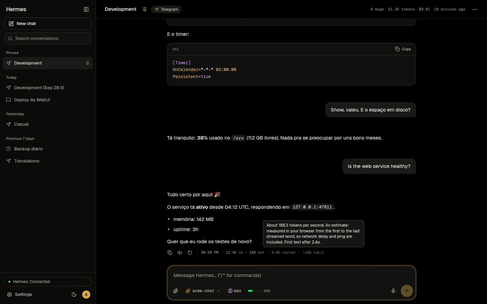
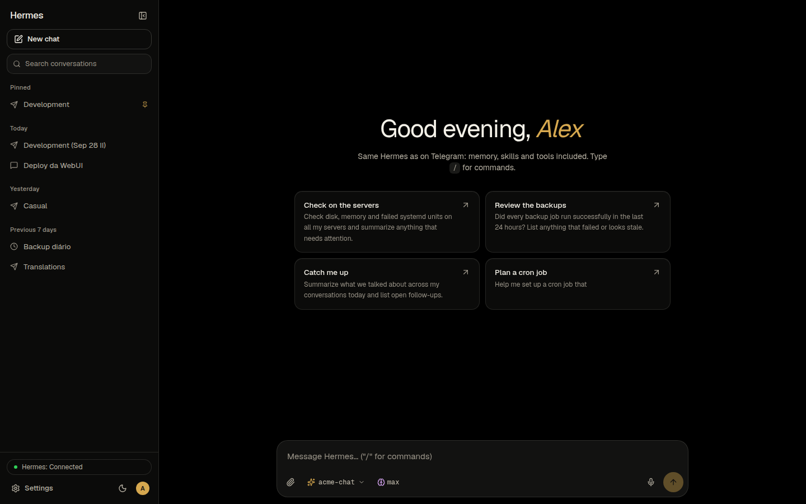
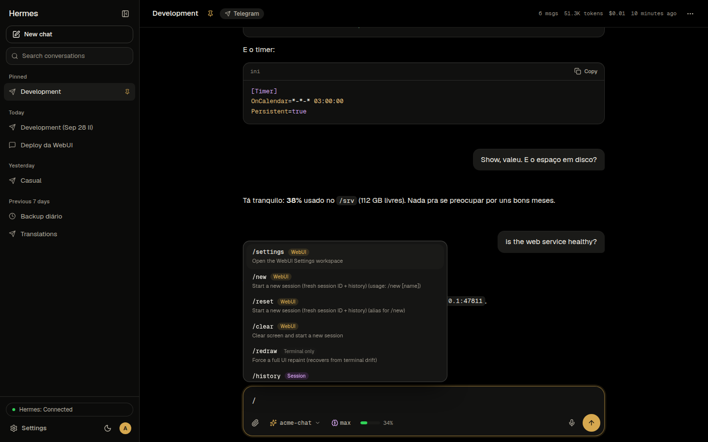
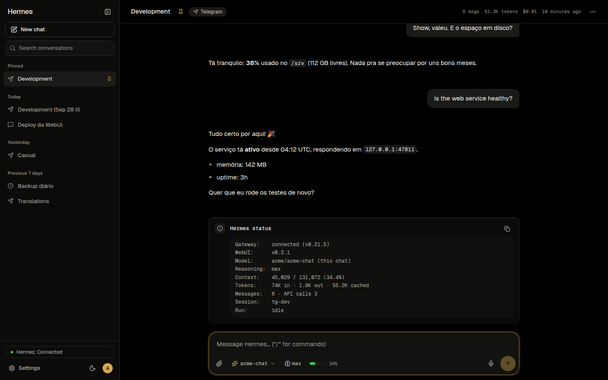
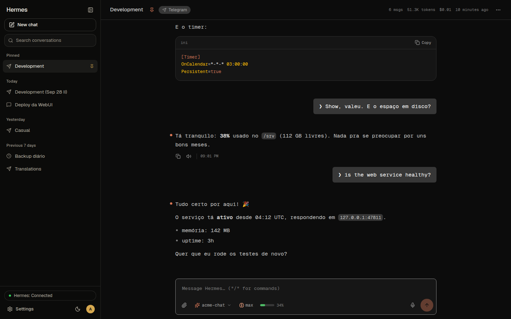
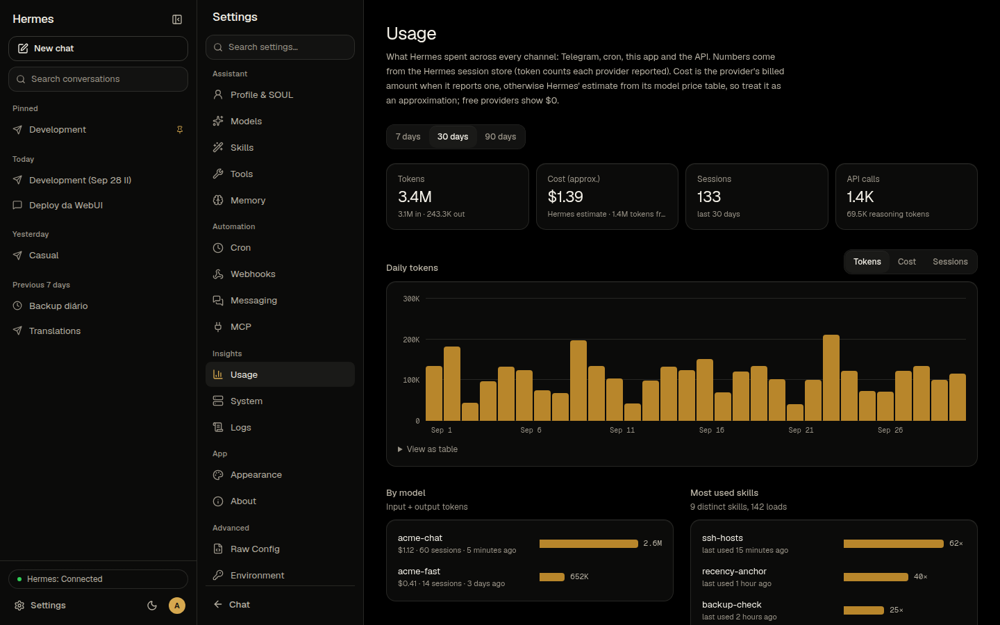
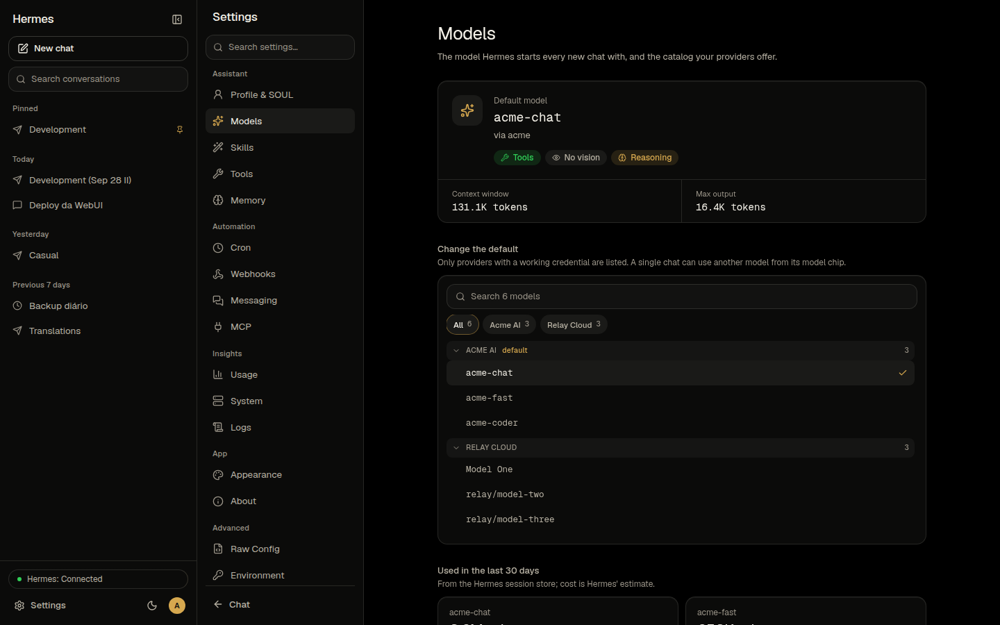
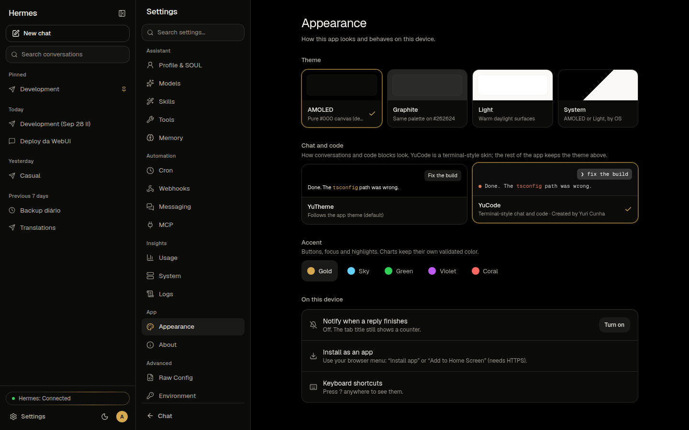
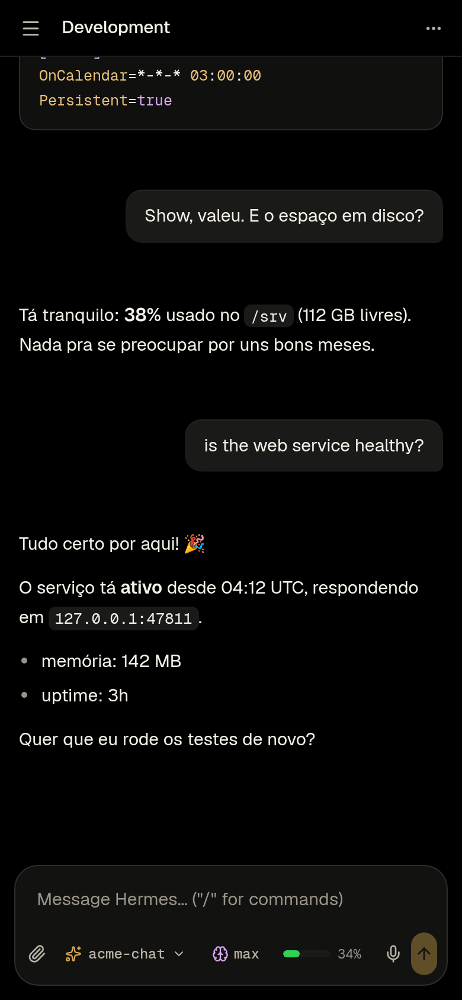

# Hermes WebUI

**A browser home for your [Hermes Agent](https://github.com/NousResearch/hermes-agent).** Chat with it, watch it work, and manage everything it does, from any device, without a terminal.

It runs next to the Hermes you already have. Hermes stays the brain and the single source of truth: your conversations, memory, skills, cron jobs and settings live in Hermes, and this app shows and drives them.

> Version **0.2.1** · [Changelog](CHANGELOG.md) · Free software ([AGPL-3.0](LICENSE))

<p align="center">
  
</p>

<table>
  <tr>
    <td width="50%"><br><sub><b>New chat</b>: greeting and prompt starters</sub></td>
    <td width="50%"><br><sub><b>Every Hermes slash command</b>, searchable</sub></td>
  </tr>
  <tr>
    <td><br><sub><b>/status</b> with the real model, reasoning and context</sub></td>
    <td><br><sub><b>YuCode</b> chat style, by Yuri Cunha</sub></td>
  </tr>
  <tr>
    <td><br><sub><b>Usage</b>: tokens, cost and sessions over time</sub></td>
    <td><br><sub><b>Models</b>: default model, catalog and readiness</sub></td>
  </tr>
  <tr>
    <td><br><sub><b>Appearance</b>: themes, accents and chat style</sub></td>
    <td align="center"><br><sub><b>On your phone</b> (installable as an app)</sub></td>
  </tr>
</table>

---

## Quick start (5 minutes)

You need **Hermes Agent already running** on the machine, and **Node.js 24+**.

**1. Get the code and build it**

```bash
git clone https://gitlab.com/isyuricunha/hermes-webui.git
cd hermes-webui
corepack enable
pnpm install
pnpm build
```

**2. Point it at your Hermes**

```bash
cp apps/server/.env.example apps/server/.env
```

Open `apps/server/.env` and set one line: `HERMES_API_KEY` = the `API_SERVER_KEY` from your Hermes `.env` (usually `~/.hermes/.env`). The other defaults already match a standard Hermes install.

**3. Start it**

```bash
pnpm start
```

**4. Open** [http://127.0.0.1:8789](http://127.0.0.1:8789) and sign in with your **Hermes dashboard** username and password. Done. 🎉

> Something off? Check that Hermes answers: `curl http://127.0.0.1:8642/health` (gateway) and that the dashboard runs (`hermes dashboard`). The full guide is in [docs/INSTALLATION.md](docs/INSTALLATION.md).

---

## What you get

**Chat**
- Streaming replies with Markdown, tables and highlighted code, a "Thinking…" state, reasoning you can open, and tool calls as compact cards with readable output (and the raw payload one click away).
- Type while Hermes is working and your message goes in as a **steer**: it shows right away and Hermes reads it at its next step.
- **Every Hermes slash command**: 118 of them. Some run right in the app (`/new`, `/model`, `/status`, `/context`, `/usage`, `/reasoning`, `/title`, `/fork`, `/export`, `/queue`…), the rest run inside Hermes with the same output as the terminal (`/personality`, `/tools`, `/insights`, `/cron`, `/curator`, skill commands…).
- **Attach anything Hermes can take**: images, audio, video, PDFs, documents, code. Audio and video play in the chat; Hermes gets the file the same way it does on Telegram.
- Per reply: tokens in and out, cache hits and an estimated tokens per second. Under the composer: the model in use, the reasoning effort (click to change) and how full the context window is.
- Files Hermes sends back (`MEDIA:/path`) show inline: images, players, download cards.
- Dictation and read aloud through Hermes' own voice providers. Approvals answered inline.

**Manage Hermes**
- Models, Profiles & SOUL, Skills (read, edit, create), Tools, Memory (entries and write approvals), Cron (create, edit, run history), Webhooks, Messaging, MCP servers, Usage charts, System health, Logs, Environment (secrets stay masked), Raw config.

**Feels right**
- Installable app (PWA), command palette (`Ctrl/Cmd+K`), keyboard shortcuts, themed tooltips everywhere, phone friendly.
- **YuTheme**: AMOLED black by default, plus Graphite, Light and System, with accent colors.
- **YuCode** chat style: a terminal-style skin for conversations and code, created by Yuri Cunha (Settings > Appearance).

## How it fits together

```
Browser ──> Hermes WebUI (this app, :8789) ──> Hermes gateway   (:8642)  chat, runs, sessions
                                            └─> Hermes dashboard (:49173) settings, commands, files
```

The browser only ever talks to the WebUI. Hermes keys and dashboard sessions stay on the server. More in [docs/ARCHITECTURE.md](docs/ARCHITECTURE.md) and [docs/SECURITY.md](docs/SECURITY.md).

## Keep it running

For a real install (start on boot, restart on failure) use the systemd user unit in [docs/INSTALLATION.md](docs/INSTALLATION.md#run-it-as-a-service). To reach it from your phone, put it behind a VPN (Tailscale, WireGuard) or an HTTPS reverse proxy; it binds to `127.0.0.1` by default.

Updating:

```bash
git pull && pnpm install && pnpm build
systemctl --user restart hermes-webui   # or stop and run `pnpm start` again
```

## Settings you might touch

All optional, in `apps/server/.env`:

| Variable | Default | What it does |
|---|---|---|
| `HERMES_API_KEY` | none | Hermes gateway key (`API_SERVER_KEY` in Hermes' `.env`). Needed whenever Hermes has one set |
| `HERMES_BASE_URL` | `http://127.0.0.1:8642` | Where the Hermes gateway listens |
| `HERMES_DASHBOARD_URL` | `http://127.0.0.1:49173` | Where the Hermes dashboard listens |
| `HOST` / `PORT` | `127.0.0.1` / `8789` | Where the WebUI listens |
| `HERMES_WEBUI_AUTH_MODE` | `hermes` | `hermes`: sign in with the dashboard account. `local`: a WebUI-only account |
| `HERMES_WEBUI_DATA_DIR` | `~/.local/share/hermes-webui` | The WebUI's own small database |
| `HERMES_WEBUI_UPLOAD_DIR` | `<data dir>/uploads` | Where attached files are saved (Hermes must be able to read it) |
| `HERMES_WEBUI_UPLOAD_MAX_MB` | `100` | Largest attachment |
| `HERMES_WEBUI_TRUST_PROXY` | none | IPs of a reverse proxy in front of the WebUI |

The complete list is in [docs/INSTALLATION.md](docs/INSTALLATION.md#all-settings).

## For developers

```bash
pnpm dev         # server with reload on :8789 + Vite on :5173
pnpm test        # server and web test suites
pnpm lint && pnpm typecheck
```

```
apps/web         React + Vite + Tailwind (the app)
apps/server      Fastify (API, sign-in, Hermes adapters)
packages/shared  Types shared by both
docs/            Guides, architecture, security, the YuTheme kit
```

See [docs/DEVELOPMENT.md](docs/DEVELOPMENT.md).

## Source code

The same repository lives on three hosts:

- GitHub: [github.com/isyuricunha/hermes-webui](https://github.com/isyuricunha/hermes-webui)
- GitLab: [gitlab.com/isyuricunha/hermes-webui](https://gitlab.com/isyuricunha/hermes-webui)
- YuGit (Forgejo): [git.yuricunha.com/isyuricunha/hermes-webui](https://git.yuricunha.com/isyuricunha/hermes-webui)

## Credits and license

Made by **Yuri Cunha**. YuTheme and YuCode are his designs. Hermes Agent is by Nous Research.

[AGPL-3.0](LICENSE): run it, study it, change it, share it.

## Chat cards and type

Hermes injects some user-role messages. The web chat does not paint those as you.

- Goal continuation: `[Continuing toward your standing goal]`
- Kanban judge: `[Continuing toward this kanban task`
- Cron: `[Cron delivery:` and `[Cronjob`
- Delegation: `[ASYNC DELEGATION`
- Background, watch, MCP reload: `[IMPORTANT:` and `[Background process`
- Out of band: `[OUT-OF-BAND` and `[Planning state preserved`
- Agent delivery: `Message from`

Settings, Appearance, Typography sets message size (13 to 18) and density on this device. It applies to the chat body, including assistant prose.
